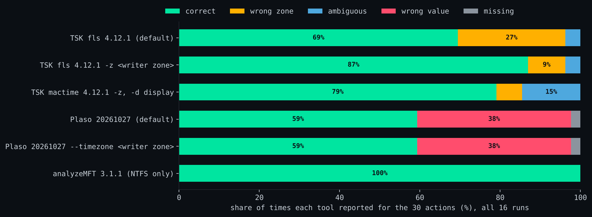
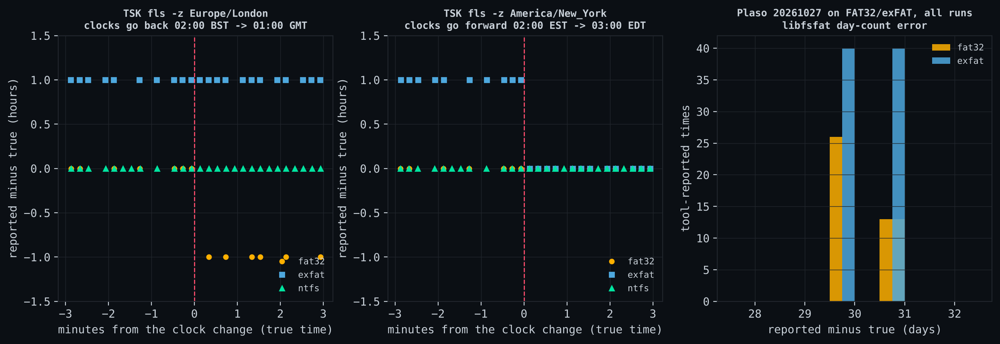
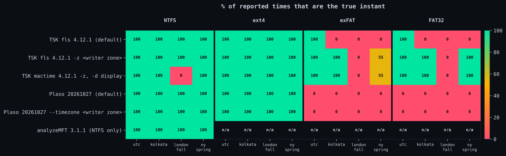
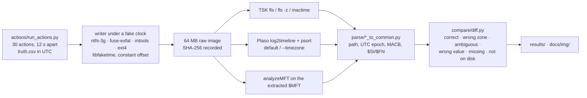

# timetruth

[](https://github.com/itsashutoshpsingh/timetruth/actions/workflows/ci.yml)


**30 scripted actions at known times, on 4 file systems, in 4 time-zone scenarios (two of them across a real DST change), checked against 6 tool configurations: 502 of 1,828 reported times (27%) were not the true instant. 264 were wrong values, 146 were the right clock reading in the wrong zone, 76 were ambiguous and 16 were missing.** Every wrong value, wrong zone and missing time was on FAT32 or exFAT, the formats of USB sticks, SD cards and camera media. On NTFS and ext4 every tool reported the true instant; the only NTFS issue was `mactime`'s zone-less display in the hour after clocks went back.

| Tool (version) | Correct | Wrong zone | Ambiguous | Wrong value | Missing | Not on disk* | Correct % |
|---|---|---|---|---|---|---|---|
| TSK fls 4.12.1 (default) | 239 | 92 | 13 | 0 | 0 | 136 | 69.5 |
| TSK fls 4.12.1 `-z <writer zone>` | 299 | 32 | 13 | 0 | 0 | 136 | 86.9 |
| TSK mactime 4.12.1 `-z`, `-d` display | 272 | 22 | 50 | 0 | 0 | 136 | 79.1 |
| Plaso 20261027 (default) | 204 | 0 | 0 | 132 | 8 | 136 | 59.3 |
| Plaso 20261027 `--timezone <writer zone>` | 204 | 0 | 0 | 132 | 8 | 136 | 59.3 |
| analyzeMFT 3.1.1 (NTFS only) | 108 | 0 | 0 | 0 | 0 | 12 | 100.0 |

\*Not on disk: no source shows the time. The file system never stored it (e.g. a rename on FAT) or a later action overwrote it. These are not counted against any tool. Full per-file-system tables: [`results/tables.md`](results/tables.md); every classification: [`results/classified.csv`](results/classified.csv).



## The three findings

**1. Plaso puts every FAT and exFAT time about a month late.** On all 8 FAT32/exFAT runs, every file-system time Plaso 20261027 reported was between 29.5 and 31 days after the truth, with or without `--timezone`. The cause is in libfsfat (the library dfVFS uses for FAT and exFAT): its day count adds the current month's days and is off by one on the day and the year. I confirmed it against hand-decoded directory entries, across three libfsfat releases (20240501 to 20260826), and in the source. The error formula predicts every case. Draft report: [`docs/upstream-reports/libfsfat-month-offset.md`](docs/upstream-reports/libfsfat-month-offset.md).

**2. TSK ignores the UTC offset that exFAT stores.** exFAT records a UTC offset next to every time, and in every run here the stored wall time plus offset gives the true instant. TSK 4.12.1 parses the offset fields but never uses them: it re-reads the wall time in whatever `-z` zone the examiner gives. Without `-z`, exFAT times were off by exactly the writer's offset (+5.5 h Kolkata, +1 h London, -4 h New York). With the correct `-z` they were still an hour off around both DST changes, because the writer used one offset for the whole mount.

**3. In the hour after clocks go back, the same local time means two instants, and nothing says so.** FAT stores local time with no offset, so a FAT time between 01:00 and 01:59 on 25 October 2026 in London is genuinely ambiguous. TSK resolves it with `mktime()`, and in one directory entry it turned the same stored 01:58:00 into 00:58 UTC for the creation time and 01:58 UTC for the modified time (reproduced twice). `mactime -d` then prints both as `Sun Oct 25 2026 01:58:00` with no zone.





## What this means for an examiner

- **FAT/exFAT media and Plaso 20261027:** do not use its file-system timestamps. Cross-check one known file with TSK first.
- **exFAT and TSK 4.12.1:** the right answer is on disk (wall time + offset), but `fls` will not give it to you. Decode the offset yourself or check against a second tool.
- **FAT and any tool:** record the source device's zone; pass it with `fls -z`; treat any time in a repeated DST hour as two possible instants.
- **Never put `mactime -d` output in a report.** It has no zone. Use `-y` (ISO 8601, UTC).
- **NTFS and ext4:** TSK, Plaso and analyzeMFT reported the true instant in every run, at every zone setting.

How this maps onto the UK Forensic Science Regulator's statutory Code (v2, section 24 on validation): [`docs/fsr-code-mapping.md`](docs/fsr-code-mapping.md).

## Method



1. **Ground truth.** [`actions/run_actions.py`](actions/run_actions.py) performs 30 actions ([list](actions/actions.md)): create, modify, copy, rename, move, delete, zip, unzip, mkdir and read. It writes the UTC instant just before each one to `truth.csv`.
2. **Evidence.** [`build/make_run.sh`](build/make_run.sh) makes a 64 MB image, mounts it with a userspace driver (ntfs-3g, fuse-exfat), or drives it with mtools (FAT32), or uses the kernel's ext4. The driver and the action script share a faked clock (libfaketime with a constant offset), so a run can start three minutes before a real DST change. Scenarios: UTC; Asia/Kolkata (+05:30); Europe/London across the fall-back on 2026-10-25; America/New_York across the spring-forward on 2026-03-08. The kernel ignores the fake clock, so ext4 runs use real time (ext4 stores UTC anyway).
3. **Tools.** [`build/run_tools.sh`](build/run_tools.sh) runs each tool the way an examiner would on a UTC workstation: default settings, then told the writer's zone.
4. **Classification.** [`compare/diff.py`](compare/diff.py) matches each truth row to any time the tool reports for that path within 2.5 s (FAT's 2 s step). It labels the result *correct*, *wrong zone* (off by whole half-hours), *ambiguous* (stored or printed local time in a repeated hour), *wrong value*, *missing*, or *not on disk*. A time counts as "on disk" if the driver's own `stat` or any tool shows it, so a tool is only blamed for what another source proves was there.
5. **Every mismatch class was then read against the tool's documentation and source** before being called a bug: [`docs/what-went-wrong.md`](docs/what-went-wrong.md). What each tool says each field means: [`docs/tool-semantics.md`](docs/tool-semantics.md).

## Further experiments

**Timestamp forgery** ([`experiments/forgery.sh`](experiments/forgery.sh), [`results/forgery.csv`](results/forgery.csv)). Five files back-dated to 2020-01-01. Does any tool still show the true creation time?

| File system | Back-dating method | Tools showing the forged time | Tools still showing the true creation time |
|---|---|---|---|
| ext4 | `touch -d` (atime, mtime) | 5 of 5 configs | 5 of 5, via crtime |
| ext4 | `debugfs` offline (all four) | 5 of 5 | 0 of 5 |
| exFAT | `touch -d` | TSK 3 of 3, Plaso 0 of 2 (month error) | TSK 3 of 3, via creation time; Plaso 0 of 2 |
| NTFS | ntfs-3g `system.ntfs_times` (all four `$SI`) | 6 of 6 | 0 of 6: ntfs-3g also rewrote `$FN`, unlike Windows |

**Clock tampering** ([`experiments/clock_tamper.sh`](experiments/clock_tamper.sh), [`results/tamper.json`](results/tamper.json)). Actions 16-30 ran with the system clock set back 48 hours. Every tool faithfully reported the stored clock: 156 of 156 checks correct against the system clock on NTFS. None of them flags the jump. A short check in [`compare/clock_anomaly.py`](compare/clock_anomaly.py) compares creation times with allocation order (MFT record or directory-entry slot). It flagged all 5 files created after the jump on both NTFS and FAT32, with no false flags on NTFS (0 of 9). On FAT32, 1 of 8 earlier files was flagged, a file that mtools rewrote with a new creation time when it was moved after the jump.

## Reproduce

```bash
sudo apt-get install sleuthkit ntfs-3g exfat-fuse exfatprogs mtools faketime e2fsprogs dosfstools attr
python3 -m venv .venv && .venv/bin/pip install -r requirements.txt
python3 -m venv /opt/plaso-venv && /opt/plaso-venv/bin/pip install plaso==20261027
sudo ./run_all.sh                      # all 16 runs (~35 min), then classify, tables, figures
sudo experiments/forgery.sh ntfs       # and ext4, exfat
sudo experiments/clock_tamper.sh ntfs  # and fat32
.venv/bin/python -m pytest -q tests    # converters and classifier, offline
```

Root is needed for loop devices and FUSE mounts. Disk images are not published. Rebuilt images will not match byte for byte (volume serials and real timing differ); each published result's image SHA-256 is in `truth/<run>/image.sha256`. Exact versions of every writer, tool and library: [`versions.md`](versions.md). CI re-classifies the committed tool output and fails if the published table no longer follows from it.

## Windows 11

Everything here was written by Linux drivers. [`docs/windows-kit.md`](docs/windows-kit.md) and [`actions/run_actions.ps1`](actions/run_actions.ps1) repeat the same 30 actions on a Windows 11 VM, adding MFTECmd, EvtxECmd and PECmd. It answers the questions Linux cannot: whether the Windows driver leaves `$FN` untouched when `$SI` is back-dated, and when Prefetch and the event log say a program ran. **It has not been run yet.**

## What went wrong

The full list, with a verdict per mismatch, is in [`docs/what-went-wrong.md`](docs/what-went-wrong.md). The short version:

- My first runs double-applied the fake clock to `stat()` results, and one FAT "rename" moved the file to the root folder. Both were caught because the driver's view disagreed with every tool.
- My first classifier looked for a renamed file's creation time under its old name and called correct answers "not on disk".
- I expected `$FN` to survive back-dating, as it does on Windows. ntfs-3g rewrites it, so the NTFS forgery result says nothing about Windows.
- MFTECmd could not run on Linux, so analyzeMFT stands in for it, labelled as such everywhere.
- ntfs-3g stamps `$MFT`'s own times with 2076-11-29. That broke my clock-anomaly check until NTFS metadata files were excluded.

## Repository layout

```
actions/      run_actions.py (Linux), run_actions.ps1 (Windows kit), actions.md
build/        make_run.sh, run_tools.sh, scenarios.sh
parse/        tsk_to_common.py, plaso_to_common.py, mft_to_common.py, common.py
compare/      diff.py, forgery_eval.py, tamper_eval.py, clock_anomaly.py
experiments/  forgery.sh, clock_tamper.sh
report/       summarise.py, figures.py
truth/        one folder per run: truth.csv, final_state.csv, run.env, image.sha256
results/      classified.csv, tables.md, by_*.csv, forgery.csv, tamper.json, summary.json, events/
docs/         reading notes, tool semantics, FSR Code mapping, Windows kit, upstream report drafts, img/
tests/        pytest suite with small fixtures
```

MIT licence. Copyright (c) 2026 Ashutosh Pal Singh.
